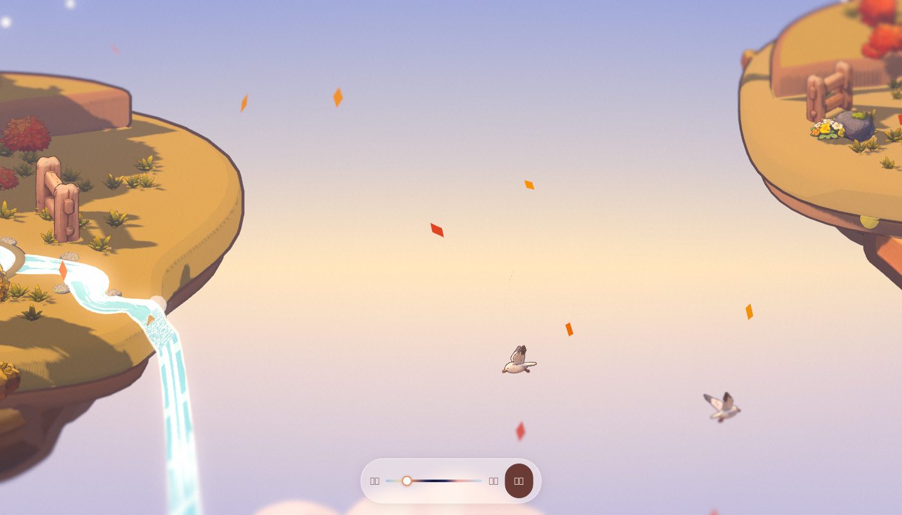

# 远近即时间 · Yuanjin Shijian

一款轻量的浏览器 3D 解谜小游戏，治愈手办风（toon 三阶着色 + 描边 + 正交等距相机）。

**核心机制**
- **拉远 = 快进**：时间加速流逝，只能旁观。
- **拉近 = 放慢**：时间变慢，可以与场景互动。
- **长按 = 倒流**：时间回溯；但玩家亲手放置的物品会在倒流中保留下来。

## 当前进度（一阶段完成：风格场景 v25）
- 两座浮岛：左岛（女孩 + 风筝、月牙台地、小水池、溪流与瀑布），右岛（奶奶 + 小屋、台地）。
- 真实且固定在世界中的昼夜循环（太阳 / 月光、星空、灯光），约 240 秒一天。
- 角色、树木、道具全部为 Tripo 生成模型，meshopt 压缩。
- 单文件成品：`dist/index.html`（约 8 MB，双击即可在 Chrome 中运行）。



## 目录
```
src/        scene.js（全部 3D 与后期）、ui.html（HUD 外壳）、build.py（打包）、three.min.js、gltf.iife.js（GLTFLoader + MeshoptDecoder）
assets/     models/*.glb（meshopt 压缩，已去除内嵌贴图）、textures/*.jpeg（底色贴图）
tools/      squeeze.mjs（GLB 压缩）、entry.js/shim.js（esbuild 打包 gltf.iife.js）
docs/       HISTORY.md（版本历史）、概念图、截图、Tripo 模型来源
dist/       index.html（可直接运行的单文件成品）
```

## 构建
`src/build.py` 把 three、加载器、模型（base64）、贴图和 scene.js 拼成单个 `index.html`。
在本仓库内使用前，把脚本里的绝对路径改为 `../assets/models/` 与 `../assets/textures/`。

新模型压缩：
```bash
cd tools && npm i @gltf-transform/core @gltf-transform/extensions @gltf-transform/functions meshoptimizer
node squeeze.mjs in.glb=out.glb
```

## 风格规则
- 粉彩、toon 三阶渐变、反向外壳描边、正交等距、硬阴影。
- 远景不出现锯齿剪影，融入雾中。
- 光照必须真实且固定于世界，不画在贴图上。
- 地面保持干净低多边形：平涂草色 + 稀疏的块状草丛。
- 两岛人物、树、房子共用同一世界尺度。

二阶段计划见 [ROADMAP.md](ROADMAP.md)。
